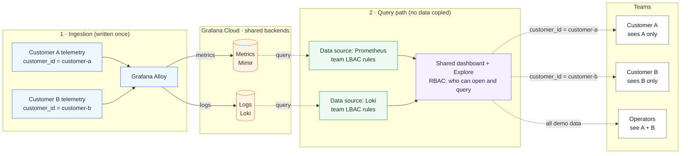

# Grafana Cloud customer-isolation demo

Synthetic metrics and logs demo showing customer isolation in one Grafana Cloud stack with RBAC and LBAC.

Two customers send telemetry to **one** metrics backend and **one** logs backend in the same stack. On a single shared dashboard, and in Explore:
- **Customer A** users see only Customer A's data;
- **Customer B** users see only Customer B's data;
- **Operators** see both.

Isolation is enforced on the server by [data source LBAC](https://grafana.com/docs/grafana/latest/administration/data-source-management/teamlbac/), not by dashboard filters. All data is synthetic; this is a demo, not a production setup.

## Architecture



How to read it:
- **Solid arrows are ingestion.** Each sample and log line is stored once, in the shared Mimir or Loki tenant.
- **Dotted arrows are the query path.** The two LBAC "data sources" are query connections to those same backends, not extra copies of the data.
- **RBAC** decides who can open the dashboard and query the data sources.
- **LBAC** adds each team's label rule to every query, so the backend returns only matching data.

## What the demo contains

| Path | Purpose |
|---|---|
| `generator.py` | Synthetic Java-style service: Prometheus metrics endpoint + JSON logs |
| `config.alloy` | Alloy pipeline: scrape → Grafana Cloud Metrics; tail logs → Grafana Cloud Logs |
| `grafana/dashboard.json` | Shared dashboard: request rate, 5xx rate, p95 latency, JVM heap, log volume, logs |
| `grafana/isolation.py` | `plan`, `setup`, `assign`, `verify`, `cleanup` for the Grafana side |
| `start.sh`, `stop.sh`, `status.sh`, `cleanup.sh` | Run, stop and inspect the generator and Alloy; delete local state |
| `.env.example` | All settings, with no credentials |
| `tests/` | Unit tests for the generator and `isolation.py` (against a stub Grafana API) |

Every series and log stream has `demo="customer-isolation"`, `customer_id`, `customer_name`, `service_name="publishing-api"` and `environment="demo"`.

The two customers behave differently:
- **Customer A** is mostly healthy.
- **Customer B** has recurring incidents: during the last 6 minutes of every 20, it shows elevated errors and latency, database timeouts and heap pressure.

`request_id` is only in the log body, never a label. Each log message names its customer, so a leak would be visible in the text.

## How RBAC and LBAC are configured

`grafana/isolation.py setup` creates:

| Resource | Configuration |
|---|---|
| Teams | `Isolation Demo - Customer A`, `- Customer B`, `- Operators` |
| LBAC data sources | One Prometheus and one Loki data source, created manually with basic auth to the stack's existing backends |
| Data source permissions | Viewer and Editor role grants **removed**; **Query** for the three demo teams only |
| LBAC rules (both data sources) | Customer A `{ customer_id="customer-a" }` · Customer B `{ customer_id="customer-b" }` · Operators `{ demo="customer-isolation" }` |
| Team role | **Data sources: Explorer** for the customer teams (enables Explore) |
| Folder and dashboard | Customer teams View, Operators Edit; no Viewer or Editor role grants |

Access-control requirements, from the [Grafana LBAC docs](https://grafana.com/docs/grafana/latest/administration/data-source-management/teamlbac/):
- **Customer users need basic role None.** The default `grafanacloud-*` data sources give Query to Viewer and Editor, and they aren't LBAC-filtered. A customer with any basic role above None could use them to bypass isolation.
  - With Grafana Cloud sign-in, the stack role is synced from the Cloud organization at every sign-in.
  - A user only appears in the stack after their first sign-in there, so check the *stack* role before assigning them.
- **One customer team per user.** Rules from several teams combine with OR.
- **Every team with Query needs a rule.** A user whose teams have no rule sees **all** data on an LBAC data source.
- **Admins are filtered too.** An admin in a team with rules is filtered by them. That's why Operators get an explicit rule instead of relying on the admin role.
- **No label selectors on the data sources' access policy token.** Access-policy label selectors override data source LBAC.

### Trusted customer labels
Isolation is only as strong as the `customer_id` label. In this demo, the generator sets it and Alloy copies it from each log line, which is acceptable for synthetic data only. With real data, set the label where data enters, from something the customer can't change (for example a per-customer pipeline or credential), and override any value the client sends.

## Setup and usage

**Requirements:**
- A Grafana Cloud stack and org admin access.
- Grafana Alloy and Python 3.9+.
- Test users for each customer.

### Credentials
Copy `.env.example` to `.env` (git-ignored, `chmod 600`), then fill in the push and query URLs and instance IDs from your stack's details page, plus three tokens:

| Variable | Token | Access |
|---|---|---|
| `GC_WRITE_TOKEN` | Cloud Access Policy | `metrics:write`, `logs:write` |
| `GC_READ_TOKEN` | Cloud Access Policy, stored in the LBAC data sources | `metrics:read`, `logs:read`, no label selectors |
| `GRAFANA_TOKEN` | Grafana service account, used by `isolation.py` | Short-lived, basic role **Admin**; delete after setup |

### Run
```bash
./start.sh                                  # generator + dedicated Alloy
python3 grafana/isolation.py plan           # preview teams and rules (no API calls)
python3 grafana/isolation.py setup          # add --dry-run to preview the changes
python3 grafana/isolation.py assign user-a@example.com customer-a
python3 grafana/isolation.py assign user-b@example.com customer-b
python3 grafana/isolation.py assign operator@example.com operators
python3 grafana/isolation.py verify         # read back config and flag risks
```

`assign` refuses a customer user whose stack role isn't None, or who is already in another demo team.

`verify` checks the configuration only. Isolation is shown by the checklist below.

**Cleanup:**
- `./cleanup.sh` stops the processes and deletes local data.
- `python3 grafana/isolation.py cleanup` removes the demo teams, data sources, folder and dashboard.
- Then revoke the tokens and delete the service account. Stored telemetry ages out with normal retention.

**Tests:**
```bash
python3 -m unittest discover -s tests
```
The tests check the requests `isolation.py` sends against a stub API; they don't prove enforcement in Grafana Cloud.

## Validation checklist

Run this signed in **as each customer user**, in their own browser session. The examples are for Customer A; swap in `customer-b` and "Customer B" when testing as Customer B. Admin queries with customer filters don't count as evidence.

1. **Dashboard:** the Customer dropdown lists only `customer-a`, and all panels and logs show only Customer A.
2. **Broad queries** in Explore:
   - On the LBAC Prometheus data source, `publishing_http_requests_total` with no filter returns only Customer A.
   - On the LBAC Loki data source, `{demo="customer-isolation"}` returns only Customer A.
3. **Other-customer queries:** `{customer_id="customer-b"}` returns nothing on either data source, and so does `{demo="customer-isolation"} |= "Customer B"` on Loki.
4. **Label discovery:** the metrics and logs label browsers show only Customer A's `customer_id` and `customer_name` values.
5. **Unrestricted data sources:** the data source picker shows only the two LBAC data sources, with no `grafanacloud-prom` or `grafanacloud-logs`.
6. **Operators:** the same dashboard shows both customers.

Record pass or fail with a screenshot for each step. Isolation is demonstrated only when every customer and the operator pass.

## Adding another customer

A new customer **reuses the existing LBAC data sources, dashboard and folder.** What's new is:
- a `customer_id` value on their telemetry;
- one team;
- one rule on each data source.

1. Add the customer to `CUSTOMERS` in `.env`, for example `customer-c:Customer C`. The generator simulates it after `./stop.sh && ./start.sh`.
2. Run `python3 grafana/isolation.py setup` again. It creates the team, grants Query, folder View and Explore, and rewrites the full rule set with `{ customer_id="customer-c" }`.
3. After the customer's users sign in once, run `assign <email> customer-c`.
4. Run `verify`, then the validation checklist as the new customer and as one existing customer.

The dashboard's Customer dropdown is populated from query results, so the new customer appears automatically, and only for users allowed to see it.
